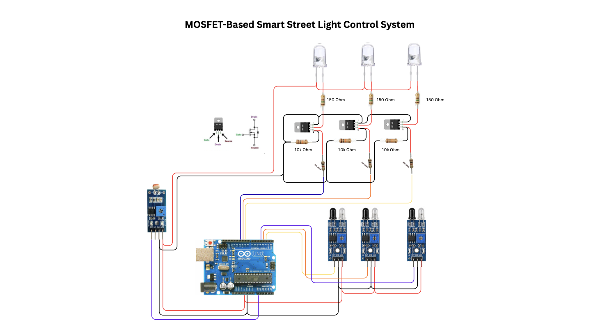

# Xpark Lab | MOSFET-Based Smart Street Light Control System

**Research • Design • Prototype • Develop**
**Bashundhara R/A, Dhaka, Bangladesh**

This open-source repository contains Arduino firmware and maker documentation for a low-cost, adaptive street-light system. The finalized system uses a digital LDR sensor for day/night control and three FC-51 infrared sensors to detect vehicles or pedestrians. An Arduino UNO switches three LED channels through IRF540N MOSFETs using PWM-capable pins.

## Prototype Hardware

*Xpark Lab hardware prototype — MOSFET-based smart street light with IR sensing.*
[Download the original hardware diagram (PDF)](docs/images/MOSFET_Based_Smart_Street_Light_IR_Sensors%20hardwear.pdf)

## Project Variants

| Variant | Coverage | IR sensors | MOSFET/PWM outputs | Sketch |
|---|---|---:|---:|---|
| Single pole | One lamp | 1 | 1 | `firmware/single_pole/single_pole.ino` |
| Three-pole finalized | One road section | 3 | 3 | `firmware/multi_pole_3_lights/multi_pole_3_lights.ino` |

## Operating Behavior

Each LED channel is ON only when both of these conditions are true:

- The digital LDR reports `Dark`.
- The corresponding IR sensor reports `Object`.

The LED is OFF in every other case. The three output channels operate independently.

## Hardware Summary

| Item | Recommendation |
|---|---|
| Controller | Arduino UNO |
| Ambient sensor | Digital 3-pin LDR module: VCC, GND, DO |
| Motion/obstacle sensors | 3x FC-51 IR obstacle sensor modules at 5 V |
| Lamp switches | 3x IRF540N N-channel MOSFETs |
| LEDs | 3x LEDs with individual 220 Ω series resistors |
| Gate resistors | 3x 100 Ω |
| Gate pull-down resistors | 3x 10 kΩ |
| Gate interface | Arduino PWM pin → 100 Ω gate resistor → MOSFET Gate |

The LEDs are switched on the low side. For every channel:

1. Connect Arduino `5V` to the LED's 220 Ω series resistor.
2. Connect the resistor to the LED anode (`+`).
3. Connect the LED cathode (`-`) to MOSFET Pin 2 (Drain).
4. Connect MOSFET Pin 3 (Source) to common GND.
5. Connect the Arduino PWM pin to MOSFET Pin 1 (Gate) through 100 Ω.
6. Connect 10 kΩ between MOSFET Gate and common GND.

The MOSFETs drive only low-voltage DC LEDs in this project. Never connect mains AC.

## Quick Start

1. Install [Arduino IDE](https://www.arduino.cc/en/software).
2. Open the desired sketch.
3. Select **Arduino UNO** under **Tools → Board**.
4. Select the board's serial port.
5. Upload and open Serial Monitor at **9600 baud**.
6. Verify LDR and IR operation using `docs/testing_and_calibration.md`.
7. Complete MOSFET and lamp wiring only after the control electronics are de-energized.

No third-party Arduino libraries are required.

## Safety Notice

- This repository demonstrates low-voltage DC LED loads only.
- Use an appropriately rated DC supply and fuse for the lamp load.
- Do not work on mains AC wiring unless you are a qualified professional.
- Disconnect power before changing MOSFET, gate, or lamp connections.
- Use a heatsink when MOSFET dissipation warrants it.
- Add an appropriate flyback diode only to inductive DC loads; use a 1N5408 where compatible.
- Verify MOSFET polarity, source ground, and heat dissipation before continuous operation.

## Pin Assignments

| Function | Arduino UNO pin | Sensor/module state |
|---|---:|---|
| Digital LDR DO | `D2` | HIGH in dark |
| IR 1 OUT | `D3` | LOW when object detected |
| IR 2 OUT | `D4` | LOW when object detected |
| IR 3 OUT | `D5` | LOW when object detected |
| MOSFET 1 Gate | `D9` PWM | Ch1 LED |
| MOSFET 2 Gate | `D10` PWM | Ch2 LED |
| MOSFET 3 Gate | `D11` PWM | Ch3 LED |

Connect all sensor VCC pins to `5V` and all sensor GND pins to Arduino GND.

## Repository Guide

- `firmware/single_pole/` — one-pole implementation.
- `firmware/multi_pole_3_lights/` — finalized three-pole digital-sensor implementation.
- `docs/wiring_guide.md` — pinouts, schematics, and assembly notes.
- `docs/bom.md` — Xpark Lab bill of materials.
- `docs/testing_and_calibration.md` — calibration and commissioning procedure.
- `docs/images/` — place schematics and build photos here.
- `test/sensor_test/sensor_test.ino` — standalone digital LDR and IR sensor test.

## Applications

- Highways and rural roads
- University campuses
- Parks and pedestrian walkways
- Parking lots
- Industrial perimeters

## Future Improvements / IoT Upgrade

The firmware can evolve to solar charging, battery monitoring, data logging, remote fault alerts, or wireless scheduling. A future ESP32-based edition could add Wi-Fi dashboard and OTA support, but it is not the target controller for this release.

## Contributing

Contributions should preserve direct Arduino UNO compatibility, non-blocking behavior, and clear safety documentation. Open an issue or submit a pull request with tested hardware details and Serial Monitor evidence.

## License

MIT License. Copyright © Xpark Lab. See `LICENSE`.
