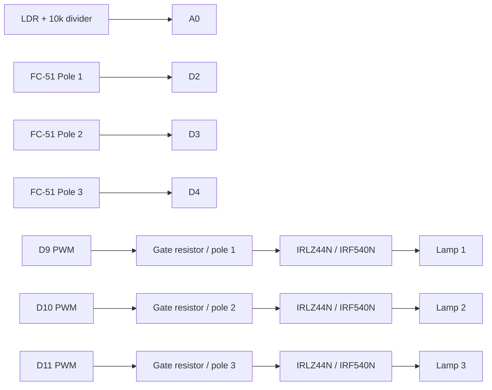

# Xpark Lab Wiring Guide

**Xpark Lab — Research • Design • Prototype • Develop**
Bashundhara R/A, Dhaka, Bangladesh

This guide covers the low-voltage DC Arduino UNO implementation. The Arduino UNO controls gates only; it does not directly power high-current lamps.

## 1. Single-Pole Wiring

### Pinout

| Interface | Arduino UNO pin | Connection |
|---|---:|---|
| LDR voltage divider | `A0` | Junction of LDR and 10 kΩ resistor |
| FC-51 OUT | `D2` | Sensor output |
| FC-51 VCC/GND | `5V/GND` | Supply and ground |
| MOSFET gate PWM | `D9` | Gate resistor |
| MOSFET source | `GND` | Logic and power ground |

### LDR divider

```text
+5V
 |
[ LDR ]
 |
 +---------------- A0
 |
[10kΩ]
 |
GND
```

The divider produces a larger Arduino ADC value for brighter light and a smaller value for darkness. Actual readings vary with LDR resistance and placement.

### Single-pole MOSFET switch

```text
+ lamp supply
       |
       +-- Lamp positive
Lamp negative
       |
       +-- MOSFET DRAIN
               MOSFET
MOSFET SOURCE --- GND

GATE: D9 -- 100Ω--220Ω -- Gate
                          |
                         10kΩ
                          |
                         GND
```

## 2. Three-Pole Wiring

### Pole pinout

| Pole | IR OUT | MOSFET gate | PWM output |
|---|---:|---:|---:|
| 1 | `D2` | `D9` | PWM |
| 2 | `D3` | `D10` | PWM |
| 3 | `D4` | `D11` | PWM |

The three lamps share `A0` through one LDR divider. Each lamp uses the same low-side MOSFET interface.



## 3. FC-51 IR Sensor

- Supply: 3.3–5 V DC
- Typical range: 2–30 cm
- Output: active LOW on standard FC-51 modules
- Adjust with the blue potentiometer.
- Clockwise increases detection range.
- Counter-clockwise decreases detection range.

Connections:

| FC-51 terminal | Arduino UNO |
|---|---|
| VCC | `5V` |
| GND | `GND` |
| OUT | Pole IR pin |

Keep sensor faces away from direct lamp reflections. If a module reports LOW when no object is present, set `IR_ACTIVE_LOW = false` or verify sensor supply and potentiometer.

## 4. MOSFET Selection

### IRLZ44N

Recommended for direct 5 V gate control. Verify the full datasheet and actual gate threshold for the selected part. Its low gate voltage requirement allows robust PWM switching from Arduino UNO output pins.

### IRF540N

Can be used for low-current LED loads and controlled loads when fully characterized. Gate threshold behavior is not guaranteed for full 5 V logic saturation. A logic-level MOSFET is preferred for reliable street-light switching.

### Gate hardware

- Gate resistor: 100 Ω to 220 Ω
- Gate pull-down: 10 kΩ from gate to source ground
- LED series resistor: 150 Ω for a typical 5 V bench LED, adjusted for LED voltage and current
- MOSFET heatsink: required for substantial continuous dissipation
- Flyback diode: 1N5408 across an inductive DC load, with cathode toward the positive supply

## 5. Low-Side Switching Safety

```text
DC supply (+) ---- Lamp/load positive
DC supply (-) ---------------------------- Common ground
Lamp/load negative --- MOSFET drain
MOSFET source ------- Common ground
Arduino PWM -------- Gate resistor -------- MOSFET gate
MOSFET gate -------- 10kΩ ---------------- Common ground
```

Both Arduino ground and load supply ground must be common. Add a fuse near the positive supply for practical enclosures. Add bypass capacitors close to the Arduino and load supply when switching noisy lamps.

## 6. Bench Assembly Order

1. Disconnect all power.
2. Build the Arduino and sensor wiring.
3. Add a 10 kΩ pull-down to each MOSFET gate.
4. Add a 100–220 Ω gate resistor.
5. Connect the MOSFET source to ground.
6. Connect only low-voltage LED loads for initial testing.
7. Use a common ground and verify every connection with a multimeter.
8. Apply power and confirm OFF behavior before any full-brightness test.
