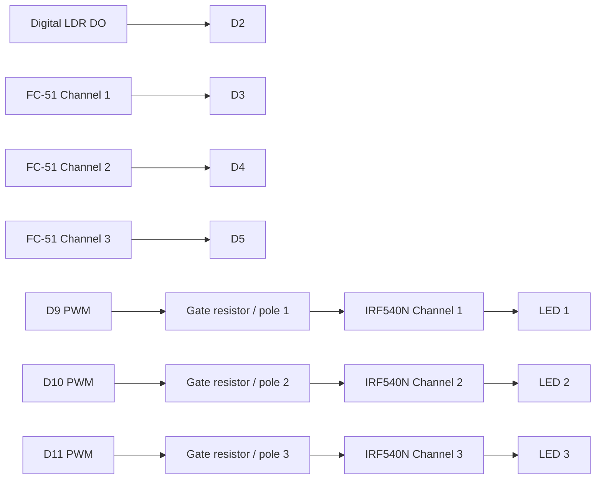

# Xpark Lab Wiring Guide

**Xpark Lab — Research • Design • Prototype • Develop**
Bashundhara R/A, Dhaka, Bangladesh

This guide covers the finalized low-voltage DC Arduino UNO implementation. The Arduino UNO controls MOSFET gates only; it does not directly power high-current lamps.

## 1. Single-Pole Wiring

### Pinout

| Interface | Arduino UNO pin | Connection |
|---|---:|---|
| Digital LDR DO | `D2` | HIGH in dark |
| FC-51 OUT | `D3` | LOW when object detected |
| FC-51 VCC/GND | `5V/GND` | Supply and ground |
| MOSFET gate PWM | `D9` | Gate resistor |
| MOSFET source | `GND` | Logic and power ground |

### Digital LDR

| LDR module terminal | Arduino UNO |
|---|---|
| VCC | `5V` |
| GND | `GND` |
| DO | `D2` |

The sketch defines DO HIGH as `Dark`. To adapt to an inverted module, change `LDR_ACTIVE_HIGH_IN_DARK` to `false`.

### Single-pole MOSFET switch

```text
+ 5V supply
       |
       220Ω resistor
       |
LED anode (+) -- LED cathode (-) -- MOSFET Drain (Pin 2)
                                        MOSFET Source (Pin 3) -- GND
                                        MOSFET Gate (Pin 1)
                                             |
Arduino D9 -- 100Ω ------------------------+
                                             |
                                            10kΩ
                                             |
                                            GND
```

## 2. Three-Pole Wiring

### Pole pinout

| Channel | IR OUT | MOSFET gate | PWM output |
|---|---:|---:|---:|
| 1 | `D3` | `D9` | PWM |
| 2 | `D4` | `D10` | PWM |
| 3 | `D5` | `D11` | PWM |

The three LEDs share one digital LDR at `D2`. Each LED uses the same low-side MOSFET interface.



## 3. FC-51 IR Sensor

- Supply: 3.3–5 V DC
- Typical range: 2–30 cm
- Output: active LOW on standard FC-51 modules
- Adjust with the blue potentiometer.
- Clockwise increases detection range.
- Counter-clockwise decreases detection range.

Connections:

| FC-51 terminal | Arduino UNO |
|---|---|
| VCC | `5V` |
| GND | `GND` |
| OUT | Pole IR pin |

Keep sensor faces away from direct lamp reflections. If a module reports LOW when no object is present, set `IR_ACTIVE_LOW = false` or verify sensor supply and potentiometer.

## 4. MOSFET Selection

### IRF540N

Use the IRF540N for low-current LED loads as specified here. Pin 1 is Gate, Pin 2 is Drain, and Pin 3 is Source. Add the 100 Ω gate resistor and 10 kΩ gate-to-ground pull-down on every channel.

### Gate hardware

- Gate resistor: 100 Ω from Arduino pin to Gate
- Gate pull-down: 10 kΩ from gate to source ground
- LED series resistor: 220 Ω for each 5 V bench LED
- MOSFET heatsink: required for substantial continuous dissipation
- Flyback diode: 1N5408 across an inductive DC load, with cathode toward the positive supply

## 5. Low-Side Switching Safety

```text
5V supply (+) ---- 220Ω ---- LED anode
LED cathode --------------- MOSFET Drain (Pin 2)
MOSFET Source (Pin 3) ----- Common ground
Arduino PWM --------------- 100Ω ----- MOSFET Gate (Pin 1)
MOSFET Gate (Pin 1) ------- 10kΩ ----- Common ground
```

Both Arduino ground and load supply ground must be common. Add a fuse near the positive supply for practical enclosures. Add bypass capacitors close to the Arduino and load supply when switching noisy lamps.

## 6. Bench Assembly Order

1. Disconnect all power.
2. Build the Arduino and sensor wiring.
3. Add a 10 kΩ pull-down to each MOSFET gate.
4. Add a 100 Ω gate resistor and 10 kΩ pull-down for each channel.
5. Connect the MOSFET source to ground.
6. Connect only low-voltage LED loads for initial testing.
7. Use a common ground and verify every connection with a multimeter.
8. Apply power and confirm OFF behavior before any full-brightness test.
